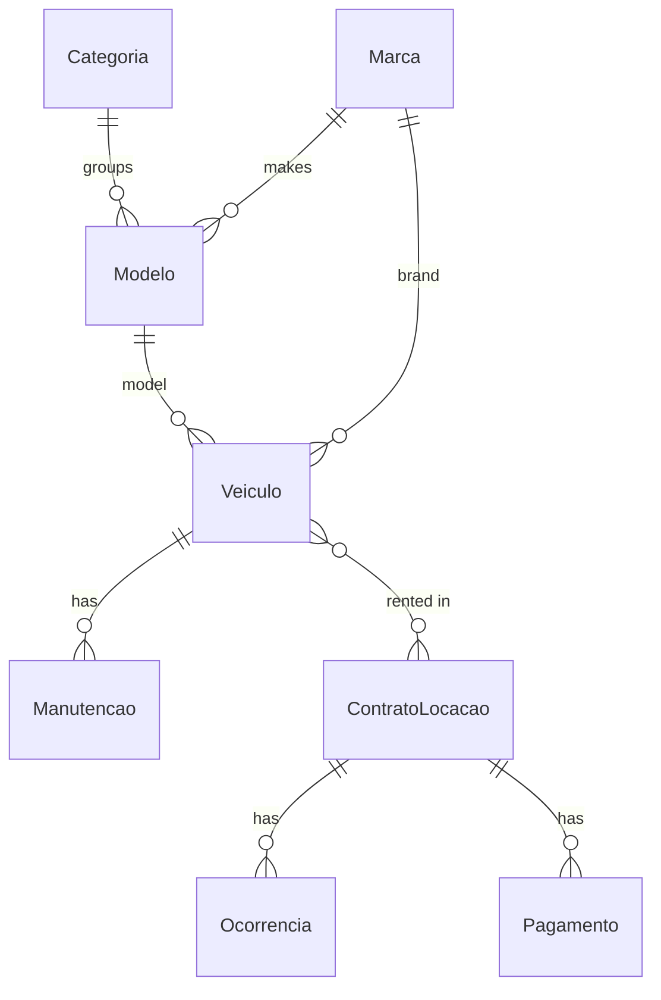

# Vehicle Rental API

REST API for a vehicle rental company — categories, brands, models, vehicles, maintenance, rental contracts, incidents and payments — with a React front-end for managing vehicle models.

Final project for the *Software Construction Technology* course (Computer Science).

**Stack:** TypeScript · Node.js · Express · Prisma ORM · MySQL · React · React-Bootstrap · Axios · Postman

## Data model



The full schema is in [`prisma/schema.prisma`](prisma/schema.prisma); the migrations are in `prisma/migrations/`.

## Endpoints

Every resource has the same four CRUD routes (`src/router/routes.ts`):

| Method | Route | Action |
|---|---|---|
| `POST` | `/<resource>` | create |
| `GET` | `/<resource>` | list |
| `PUT` | `/<resource>/:id` | update |
| `DELETE` | `/<resource>/:id` | delete |

Resources: `categoria`, `marca`, `modelo`, `veiculo`, `manutencao`, `contrato-locacao`, `ocorrencia`, `pagamento`.

## Project structure

```text
├── src/
│   ├── index.ts         Express server (port 3000)
│   ├── router/          routes
│   ├── controllers/     HTTP layer: reads the request, answers with JSON
│   └── models/          data access with Prisma
├── prisma/              schema and migrations (MySQL)
└── frontend/            React app (Create React App) — vehicle models page
```

## How to run

Requirements: Node.js 18+ and MySQL.

**API**

```bash
npm install
copy .env.example .env      # Linux/macOS: cp — then set DATABASE_URL
npx prisma migrate deploy   # creates the tables
npm run dev                 # http://localhost:3000
```

**Front-end** (with the API running)

```bash
cd frontend
npm install
npm start                   # http://localhost:3001
```
